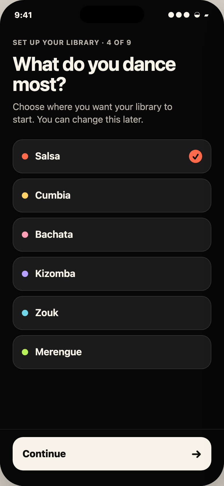
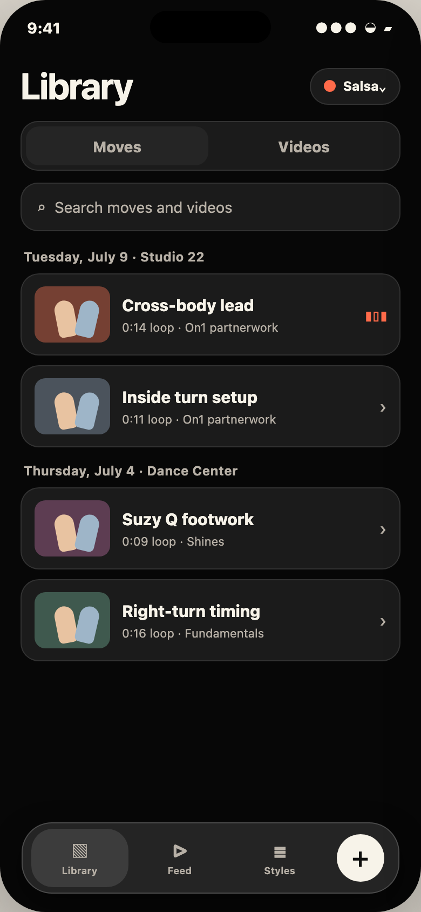
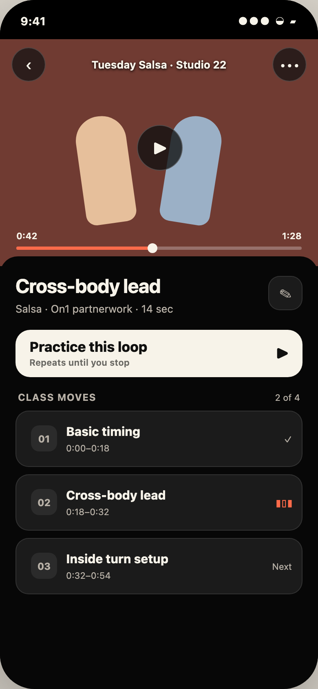

# 567 design foundation — approval proposal

> **Approved 2026-07-14, with minimalism correction.** This records the representative proposal that informed the finalized system. It does not authorize migration by itself.

## Proposal in one sentence

Warm white identifies the one next action. Every other state gets one sufficient visible indicator—never a stack of color, shape, text, and glyphs that all repeat the same fact.

## Semantic role matrix

| Role | Purpose | Prominence | Color / surface behavior | Non-color indicator |
|---|---|---|---|---|
| Primary action | Advance or begin the screen's main task | Highest; one per state | Warm-white fill + stage ink. Accent may appear in a compact progress/play glyph, never as a second full fill. | Verb-first label; optional directional/play glyph. |
| Selection | Show a saved choice that persists after the tap | Medium | The row keeps its ordinary graphite surface. Never warm-white fill. | Checkmark only; expose the selected trait to assistive technology without adding visible text. |
| Active navigation | Show current destination or local mode | Medium, subordinate to content | Native neutral Liquid Glass for app chrome; one raised graphite container for in-content segmented controls. No style accent in global chrome. | The selected container is the sole visible cue; expose the selected trait semantically. |
| Progress | Show position through onboarding, video, or practice | Medium; contextual | Style accent fills a neutral track or compact current marker. | Count/time text such as “4 of 9” or “0:42 / 1:28”. |
| Success | Confirm an outcome, not an ongoing selection | Brief high emphasis, then recedes | System green in a compact icon/edge; return to neutral surfaces after acknowledgement. | Checkmark + explicit result text; VoiceOver announcement for async completion. |
| Warning | Flag recoverable attention | Medium/high when relevant | System orange on a compact icon/edge or neutral warning tray; never recolor the whole canvas. | Warning glyph + plain-language consequence and recovery action. |
| Destructive | Identify irreversible or hard-to-recover action | Quiet until intentionally revealed; high in confirmation | System red text/icon in menus and confirmation dialogs. Never the default/primary role. | Trash glyph, destructive role, explicit object in label, confirmation where needed. |

## Representative snapshots

### 1. Onboarding selection

The selected Salsa row remains a row, not a CTA. Its only selection indicator is the checkmark. The coral dot identifies Salsa; it does not change with selection. The only warm-white surface is **Continue**.

### 2. Library / home

The content-mode segment uses one neutral selected container. The playing move uses one coral waveform; it does not also change surface, add a rail, or spell out “Playing.” Native bottom navigation remains neutral.

### 3. Practice / video detail

The video stays immersive and black-framed. Coral identifies playback progress; one waveform identifies the active clip. **Practice this loop** is the only primary fill. Editing remains a quiet secondary control.

## Settled if approved

- One primary action per state; warm white is reserved for it.
- Family Values is the primary experience-craft framework, applied in order: simplicity, fluidity, then selective delight. 567 adopts the principles heavily without copying Family's wallet UI or tokens.
- Minimalism is semantic: use one sufficient visible indicator for each state or fact. Do not stack a notch, label, checkmark, surface change, and color change to repeat “selected.” Accessibility traits and values provide nonvisual semantics without adding visible redundancy.
- Selection, playing, and local navigation use one context-appropriate cue each: checkmark, waveform, or selected container.
- Dance-style accent is content metadata and temporal signal: marker, playhead, progress, or brief completion detail—not page fill or global navigation tint.
- Quiet Stage has three levels only: canvas, content surface, and structurally raised surface. Selection does not automatically change levels. Edge strokes clarify boundaries; shadows are unnecessary on the flat canvas.
- Content cards use 16–18pt continuous corners; primary actions use 18pt; compact controls use capsules/circles. Avoid applying one oversized radius everywhere.
- Native tab/navigation chrome stays neutral Liquid Glass. Custom content surfaces stay solid.
- Motion explains state: the checkmark settles in, playback progress moves directly, and local tab content moves directionally. Reduce Motion removes travel and retains the same single static cue.
- Every state remains programmatically exposed to assistive technology; every target is at least 44pt; Dynamic Type may reflow content rather than truncate the primary label.

## Remaining questions for Adrian

1. Does “Library” remain the product home, or is it only an organization destination beside the feed? The visual recipe works either way, but title/empty-state emphasis depends on that information-architecture decision.

## Evidence and rationale

- The current POC gives selected rows, active content modes, and CTAs the same light fill. The hierarchy is accessible but makes three different meanings compete.
- Apple recommends persistent highlight for navigational list selection, but a checkmark for an option that toggles state; the proposal combines a persistent neutral row with an explicit check/value where the choice is saved. See [Lists and tables](https://developer.apple.com/design/human-interface-guidelines/lists-and-tables).
- Apple describes primary buttons as the most likely action and warns against giving destructive actions that role. See [Buttons](https://developer.apple.com/design/human-interface-guidelines/buttons).
- Apple advises interfaces not to rely on a single perceptual method and to support larger text; this proposal makes accent redundant with labels, glyphs, and shape. See [Accessibility](https://developer.apple.com/design/human-interface-guidelines/accessibility/).
- Apple recommends using Liquid Glass sparingly and notes that standard framework components adopt it automatically. This supports neutral system chrome plus solid content surfaces. See [Materials](https://developer.apple.com/design/human-interface-guidelines/materials).
- Family Values' gradual revelation, continuity, and selective emphasis support one clear action, stable persistent elements, and restrained delight rather than copying Family's tokens. See [Family Values](https://benji.org/family-values).
- The supplied Family reference separates quiet modules from local actions; the Apple Fitness reference uses accent to identify the workout mode and its play action while keeping global navigation legible and structured.

## Proposed edits to `docs/design-system.md` after approval

1. Replace the provisional `stageSelectionSurface` role with `stageActionSurface` (warm white). Selection keeps the ordinary content surface and uses one context-appropriate glyph; `stageRaisedSurface` remains available for structural elevation such as a selected segment container.
2. Add the semantic role matrix above under a new **Interaction semantics** section.
3. Add three component recipes: primary action, single-cue selected/playing row, and single-container in-content mode selector.
4. Define the three-level surface hierarchy, 16–18pt card/action radii, and capsule/circle exceptions.
5. Add the motion grammar and Reduce Motion substitution.
6. Add context rules for onboarding, library/content, and immersive practice, including the neutral Liquid Glass boundary.
7. Keep the approved style palette unchanged; clarify that semantic success/warning/destructive colors remain system green/orange/red and never inherit the dance-style accent.

## Approval record

Adrian approved the direction on 2026-07-14 with one correction: minimalism is a general interaction principle, and the selected style row should use only a checkmark—no “Selected” text or leading notch. The correction is applied throughout these snapshots and the finalized system.
